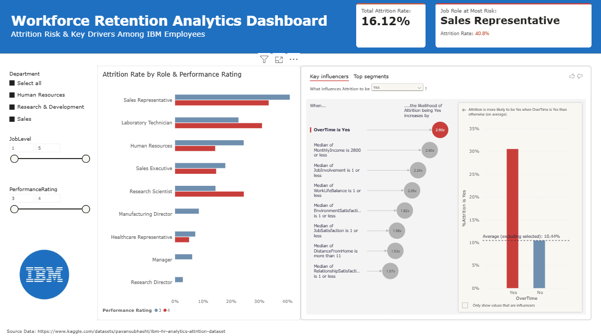

# Workforce Retention Analytics Dashboard

Interactive Power BI dashboard analyzing employee attrition, specifically targeting high-performing talent (`PerformanceRating >= 3`) across job roles, performance tiers, and operational turnover drivers using the IBM HR Analytics dataset.

## 1. Data Reconciliation & Preparation
* **Source & Grain:** IBM HR Analytics Employee Attrition & Performance dataset (`IBM_HR_Data_Ready`), structured at the individual employee record level across departments, job roles, job levels, performance ratings, and other employee attributes. See data source here at https://www.kaggle.com/datasets/pavansubhasht/ibm-hr-analytics-attrition-dataset
* **Data Type & Integrity Audits:**
  * Verified and standardized column data types prior to modeling (confirming numeric fields such as `PerformanceRating` and `JobLevel` are stored as numbers rather than text, and `Attrition` flags are cleanly standardized).
  * Audited missing values, duplicate records, and category labels so aggregated employee headcount and attrition percentages reconcile accurately. Documentation of data audit in the `IBM Workforce Retention and Competency Analytics Workbook.xlsx`
  * Flagged outliers through Python Pandas Library, utilizing the IQR method in `outlier_flagging.ipynb` to produce the data-ready CSV file.
* **Measure & Visual Sanity Checks:**
  * Built transparent DAX measures (`MAXX`, `TOPN`, `SUMMARIZE`, `CONCATENATEX`) with explicit percentage formatting (`0.0%` / `0.00%`) so KPI callouts and reference labels remain accurate across slicer selections.
* **Analytical Scope:** Focused retention risk evaluation on high-performing employees (`PerformanceRating` 3–4) while keeping full interactive filtering (`Department`, `JobLevel`, `PerformanceRating`) available on the report canvas.

## 2. Answering Key Business Questions
* **What is our baseline attrition exposure?**
  * Across the full employee scope, overall attrition stands at **16.12%**.
* **Which roles and performance tiers face the highest regrettable turnover risk?**
  * High-performer attrition is heavily concentrated in specific roles: **Sales Representative** emerges as the highest-risk role at **40.8%** attrition in the top risk slice, followed by elevated attrition in **Laboratory Technician** and **Human Resources**.
* **What operational factors are most strongly associated with employees leaving?**
  * Key influencer modeling identifies **OverTime = Yes** as the top driver—increasing the likelihood of attrition by **2.93x**—followed by lower compensation (**MonthlyIncome <= $2,800** at **2.60x**) and lower **JobInvolvement** (**2.24x**), pointing directly to workload burnout, pay compression, and engagement as actionable retention levers.

## 3. Repository Structure & Interactive Access
* `Workforce_Retention_Analytics.pbix` — Interactive Power BI report file containing the data model, DAX measures, and visual layout.
* `IBM-Workforce-Retention-Analytics-Dashboard.png` — Full-resolution preview of the dashboard.

> **How to Explore Interactively:** Download the `.pbix` file and open it in Power BI Desktop to filter dynamically by `Department`, `JobLevel` (`1`–`5`), and `PerformanceRating` (`3`–`4`).